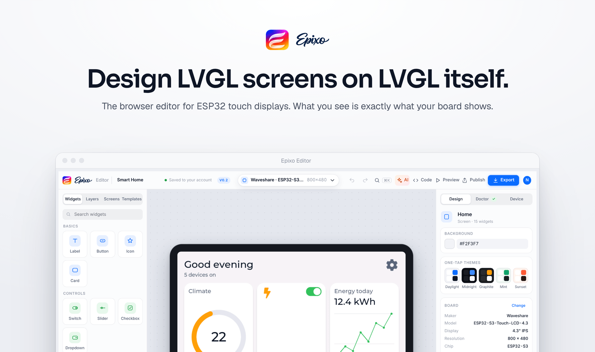
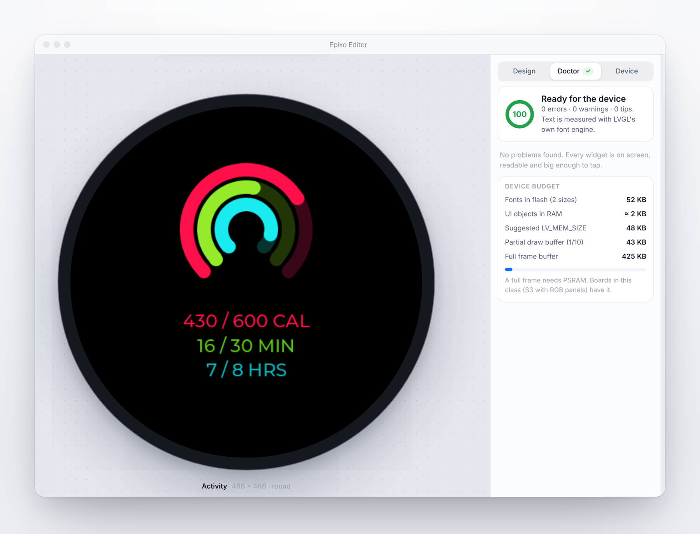
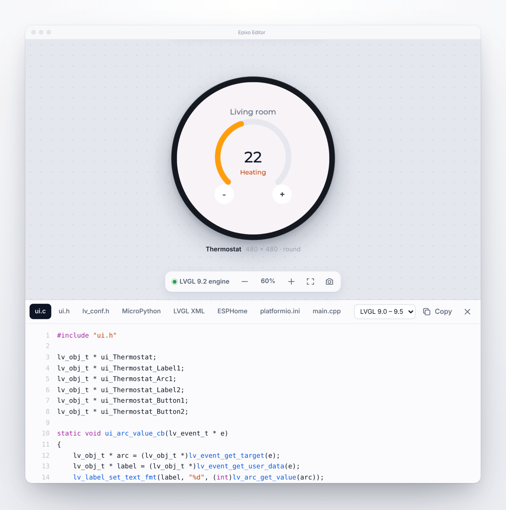
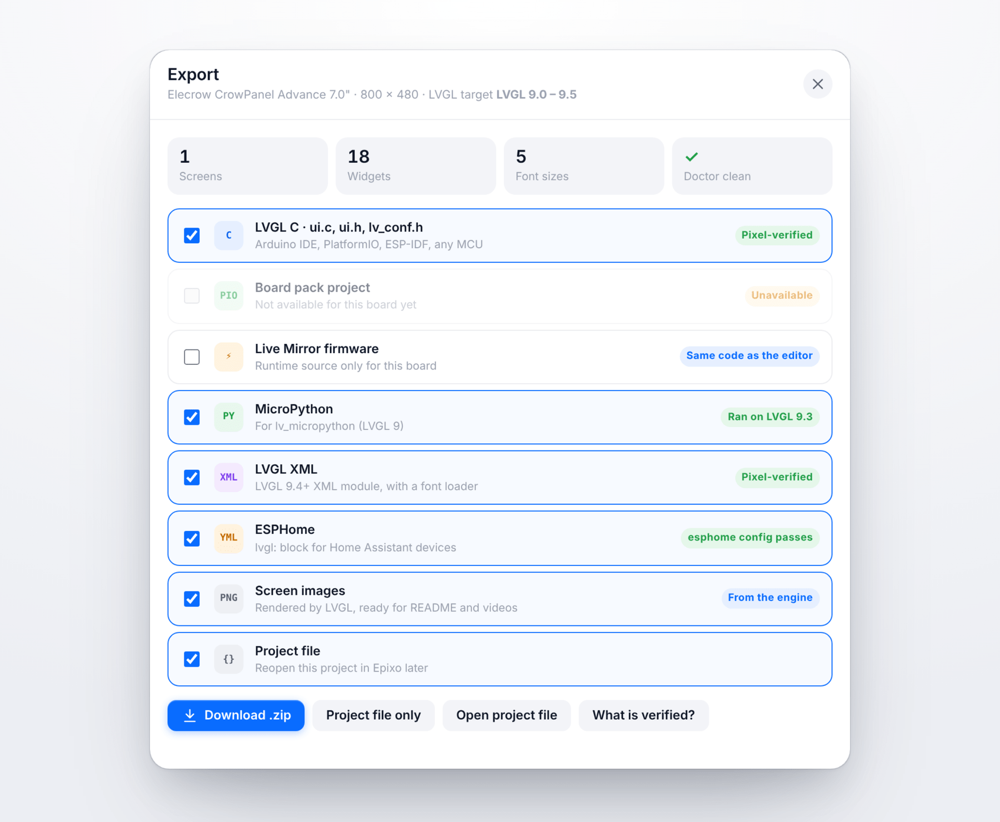
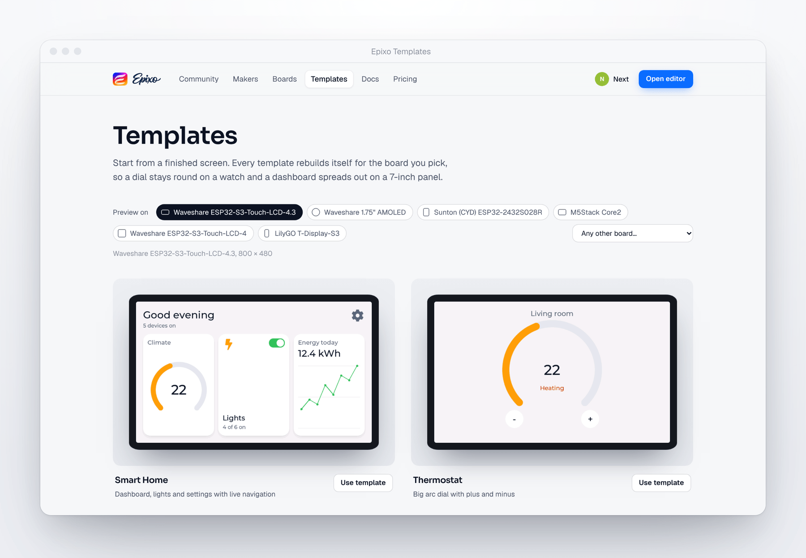
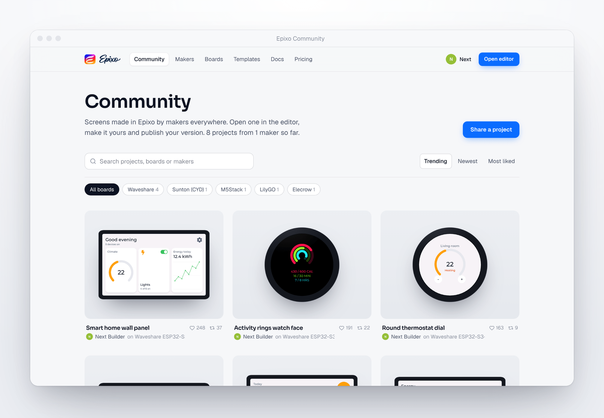
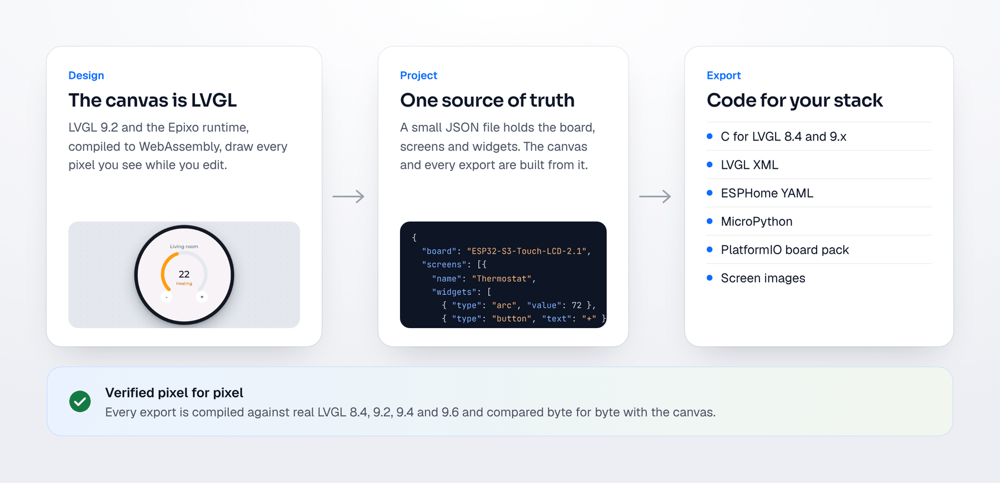

  

  
  
  
  
  

  <a href="#overview">Overview</a>&nbsp;&nbsp;·&nbsp;&nbsp;<a href="#features">Features</a>&nbsp;&nbsp;·&nbsp;&nbsp;<a href="#supported-hardware">Hardware</a>&nbsp;&nbsp;·&nbsp;&nbsp;<a href="#exports">Exports</a>&nbsp;&nbsp;·&nbsp;&nbsp;<a href="#how-it-works">How it works</a>&nbsp;&nbsp;·&nbsp;&nbsp;<a href="#roadmap">Roadmap</a>

 

## Overview

**Epixo** is a visual editor for [LVGL](https://lvgl.io), the graphics library behind most ESP32 touch displays. Choose your board, drag in buttons, sliders, arcs and charts, and export code that compiles the first time.

Most UI tools draw an approximation of LVGL and hope the device agrees. Epixo doesn't guess. Its canvas **is** LVGL, compiled to WebAssembly and running in your browser, so every pixel you design is the pixel your board will show.

It runs entirely in the browser, with nothing to install, and is built for beginners and professionals alike. A short welcome helps first-time makers pick their board and start from an idea, a blank screen or a sentence for AI.

 

## Features

### Design with AI, including Claude and ChatGPT

Type what you want into the **Ask AI** bar, like “a thermostat with a big dial” or “make this button bigger”, and watch it build with real widgets. Every change is one undo step.

Already use Claude or ChatGPT? Connect it to Epixo and design from there. Epixo is an [MCP](https://modelcontextprotocol.io) server, so your AI can create projects, build and change screens, line widgets up, run Design Doctor and read the code while you watch the editor update live. Connect from your account at `/connect`, or run the [local server](apps/mcp/README.md) for an offline setup that also lets your AI look at real LVGL renders of its own work.

### Design Doctor

A built-in reviewer checks every screen as you work. It finds text that won't fit, buttons too small for a finger on your screen size, low contrast in sunlight, clashing names and broken links. Most problems fix in one click. It also estimates flash and RAM use before you ever compile.

### Code you can read

The code updates live as you design. It is plain, idiomatic LVGL with sensible names, so you can open it, understand it and keep building on it. Switch between C, MicroPython, LVGL XML, ESPHome and PlatformIO files at any time.

### Export for your stack

One click gives you a zip with everything you chose: C for LVGL 8.4 or 9.x, MicroPython, LVGL XML, ESPHome YAML, a ready-to-build PlatformIO project for supported boards, and screen images for your README.

### One design, every screen

Start from eight finished templates, from a smart home panel to a door keypad. Each one rebuilds itself for the board you pick, so a dial stays round on a watch and a dashboard spreads out on a 7-inch panel.

### A community of makers

Publish your screens with a single click. Anyone can open your project in the editor, remix it and publish their own version, and the original maker is always credited. Maker profiles show your work, your links and whether you are open to hire.

### And more

| Feature | What it does |
|---|---|
| **Live Mirror** | See your design on a real board over USB while you edit. |
| **AI design** | Describe a screen or upload a sketch and get an editable layout. |
| **Feels native** | Floating glass panels, spring motion, light and dark mode, focus mode, pinch and pan, and a layout for phones. |
| **13 widgets, 42 icons** | Labels, buttons, switches, sliders, arcs, bars, charts, dropdowns, LEDs and more. |
| **Themes** | Restyle a whole project in one tap, from Daylight to Midnight. |
| **Keyboard first** | Command menu, Ask AI with `/`, nudging, duplicating and full undo history. |
| **Accessible** | Touch-target and contrast checks, and full reduced-motion support. |

 

## Supported hardware

Epixo knows **113 displays from 13 makers**, including 22 round screens. Pick one and the editor sets the resolution, shape, touch and drivers for you.

| Maker | Boards | | Maker | Boards |
|---|:-:|---|---|:-:|
| Waveshare | 24 | | Guition | 6 |
| Elecrow | 14 | | Seeed Studio | 6 |
| Sunton (Cheap Yellow Display) | 13 | | Makerfabs | 4 |
| Viewe | 13 | | Adafruit | 2 |
| LilyGO | 12 | | Arduino | 1 |
| Espressif | 10 | | Wireless-Tag | 1 |
| M5Stack | 7 | | | |

Every board shows how its details were checked: **Driver-verified** (taken from official driver configurations), **Maker-checked** (confirmed against the maker's documentation) or **Listed** (published specs). Any other display works through a custom size.

 

## Exports

Every change to the code generators is tested against real toolchains. The suite builds 57 projects, covering every template on seven different boards plus one project that uses every widget and option, and compares each result with the editor.

| Export | How it is checked | Result |
|---|---|:-:|
| C for LVGL 8.4, 9.2, 9.4 and 9.6 | Compiled with `-Wall -Wextra -Werror`, rendered, compared byte for byte | 57 / 57 identical |
| LVGL XML | Loaded by LVGL 9.4's XML engine, rendered and compared | 57 / 57 identical |
| ESPHome YAML | Validated with `esphome config` | 57 / 57 valid |
| MicroPython | Run on lv_micropython, rendered and compared | 56 / 57 identical* |

* The MicroPython binding does not expose LVGL's spinner, so it is drawn as an animated arc instead.

 

## How it works

A project is a small JSON file describing the board, the screens and the widgets. The canvas turns it into a script for the Epixo runtime, which builds real LVGL objects inside WebAssembly. The exporters turn the same file into code. Because both paths start from one source, the test suite can prove that what you export draws exactly what you designed.

| Part | What it is |
|---|---|
| `apps/editor` | The editor: plain JavaScript with no framework, plus the LVGL engine in WebAssembly |
| `apps/web` | The Epixo website and community, built with Next.js and running on Cloudflare's edge, plus the remote MCP endpoint for AI apps |
| `apps/mcp` | The local MCP server: lets AI apps design in Epixo on your computer, with a live editor and real LVGL renders |
| `runtime` | The small C runtime that builds LVGL screens from a script, shared by the canvas, Live Mirror and exports |
| `engine` | The WebAssembly build of LVGL and the runtime |
| `tests` | Unit tests and the pixel verification suite |

 

## Privacy and security

Sign-in uses GitHub or Google, so Epixo never stores a password. Projects stay private until you publish them. Every request is validated and rate limited, uploads are inspected, and a strict Content Security Policy keeps third-party scripts out. The code is scanned with CodeQL on every change.

Found a problem? Please report it privately, as described in the [security policy](SECURITY.md).

 

## Roadmap

- [x] LVGL engine in the browser with 113 boards
- [x] Pixel-verified exports for C, XML, ESPHome and MicroPython
- [x] Community, remixing and maker profiles
- [x] Guided first run and a friendlier editor for beginners
- [x] Design from Claude, ChatGPT and other AI apps over MCP
- [ ] "Which export do I need?" chooser
- [ ] Images, tabs, rollers and keyboards
- [ ] Live data bindings from sensors
- [ ] Team projects and shared libraries

 

## Feedback

- **Found a bug?** [Open a bug report](https://github.com/NextBuilder/Epixo-Editor/issues/new?template=bug_report.yml)
- **Missing a board?** [Request it](https://github.com/NextBuilder/Epixo-Editor/issues/new?template=board_request.yml)
- **Have an idea?** [Suggest a feature](https://github.com/NextBuilder/Epixo-Editor/issues/new?template=feature_request.yml)

See [CONTRIBUTING.md](CONTRIBUTING.md) for how we work with contributions.

 

## License

Copyright © 2026 Kishan Pratap Singh, Next Builder. All rights reserved. The source is published so it can be read and reviewed; it may not be copied, modified or redistributed. See [LICENSE](LICENSE).

**What you make is yours.** Designs you create and the code Epixo generates from them belong to you, including the runtime files bundled into your exports, so you can ship them in personal and commercial products.

Epixo is built on [LVGL](https://lvgl.io). Board names and trademarks belong to their owners. See [third-party notices](THIRD_PARTY_NOTICES.md).

 

   
  Designed and built by <b>Next Builder</b>

